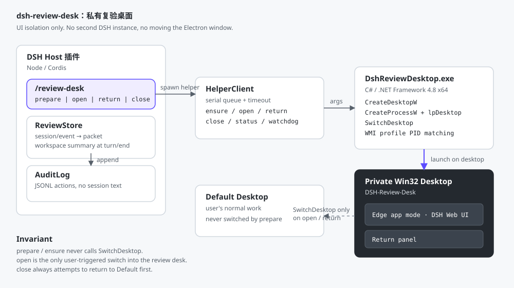

# dsh-review-desk

> 把 DSH Web UI 和完整 Agent 任务放到一个私有 Win32 桌面：需要复验时切过去，平时主桌面完全不受影响。


---

## 解决的问题

DSH 在跑长任务时，用户仍然要在当前桌面工作。把 DSH 窗口直接切来切去，会打断输入、抢焦点，也容易误操作。

`dsh-review-desk` 不改 DSH 的 Electron 窗口，也不启动第二个带 GUI/Web 的 DSH 实例。它在后台创建一个**私有 Win32 桌面**，把 Edge app 模式的 DSH Web UI 放进去；只有用户显式执行 `open` 时才切过去。

`run` 可以把一段 PowerShell 任务直接放到这个私有桌面执行；`task` 更会启动一个独立的 **DSH headless Agent**，让完整的一次 Agent 任务也在私有桌面里跑完，只把最终答案回传当前会话。

## 它做什么

- `prepare`：**只在后台**创建/复用私有桌面，启动 Edge 和返回 panel，**不切屏**；
- `open`：显式切到复验桌面；这是唯一的切屏入口；
- `return`：切回默认桌面，并尽量恢复原前台窗口；
- `close`：切回默认桌面，结束 Edge/panel，删除 Edge profile；
- `status`：查看活动桌面和进程；
- `run`：在复验桌面里执行 PowerShell 任务，返回退出码和输出，**不切屏**；超时由 `runTimeoutSeconds` 控制，输出按 `runOutputLimit` 截断；
- `task`：启动独立 DSH headless Agent，在复验桌面完成一次完整任务，返回最终答案，**不切屏**；超时由 `taskTimeoutSeconds` 控制，同样按 `runOutputLimit` 截断；
- `list` / `show`：查看最近复验记录；
- `audit`：查看桌面动作审计。

## 它不做什么

- 不是 Windows 11 虚拟桌面：私有桌面没有 Explorer 任务栏，也不在 `Win+Tab` 列表里；
- 不是安全沙箱：它只隔离 UI，不隔离权限、文件、网络；`run`/`task` 以当前用户权限执行，不做权限降级；
- 不做硬性 CPU/GPU 隔离：资源低干扰是 best-effort；
- 不自动审批、不自动复验、不复制会话；
- 不启动第二个带 GUI/Web 的 DSH 实例；`task` 只启动一次性 headless worker，用完退出；
- 不在任何自动流程里调用 `open`。

## 快速开始

### 环境

- Windows 10/11 x64；
- DeepSeekRuntime `>= 0.2.1-rc.2`；
- Microsoft Edge（默认路径找不到时用 `edgePath` 指定）；
- 构建 helper 需要 .NET Framework 4.8 的 `csc.exe`。

### 安装

先退出 DeepSeekRuntime（pnpm 会改写 profile 的 `node_modules`），再运行：

```powershell
powershell -NoProfile -ExecutionPolicy Bypass -File .\scripts\install.ps1
```

脚本只改 profile 的 `package.json`（`file:` 依赖 + `dsh.profile.bundles`），不会动 `cordis.patch.yml`。装完重启 DeepSeekRuntime。

### 使用

```text
/review-desk prepare     # 后台准备，不切屏
/review-desk run Get-ChildItem   # 在复验桌面跑命令，不切屏
/review-desk task "跑一遍测试并总结"  # 启动独立 headless Agent，不切屏
/review-desk list        # 看最近复验记录
/review-desk open        # 显式切到复验桌面
/review-desk return      # 切回工作桌面
/review-desk close       # 清理
```

`prepare` 后 `status` 应该显示 `active=Default`，但 `desktop=DSH-Review-Desk`、`browserPid`/`panelPid` 已存在。这就是正确状态：**桌面在后台，当前桌面没变**。

### 从复验桌面返回

私有桌面里唯一的可见入口是右下角的返回 panel（配置了 `panelSeconds` 时会自动返回）：

- 点「返回工作桌面」，或按 `Ctrl+Alt+Shift+F12`：切回默认桌面，Edge 留在后台，下次 `open` 直接复用；
- 点「关闭复验桌面」：切回默认桌面，并按 `close` 的语义清理 Edge、Edge profile 和状态文件。

`Ctrl+Alt+Shift+F12` 由 panel 自己注册，因此只在该私有桌面处于前台时生效。注册失败（组合被别的程序占用）只写日志，panel 的两个按钮仍然可用。

### 在复验桌面跑任务

```text
/review-desk run Start-Sleep 5; Get-ChildItem
/review-desk run notepad
/review-desk run & 'C:\path\verify.ps1'
```

`run` 的行为：

- 用 `STARTUPINFO.lpDesktop = WinSta0\DSH-Review-Desk` 启动 `powershell.exe`；
- 任务派生的 GUI 子进程继承私有桌面，不会弹到当前桌面；
- 等待任务结束，把 stdout/stderr 和 exit code 返回会话；
- 超时由 `runTimeoutSeconds` 控制，超时会按进程树终止；
- **不调用 `SwitchDesktop`**，当前桌面保持不变。

### 完整 Agent 任务

```text
/review-desk task 跑一遍测试并总结失败原因
/review-desk task 检查 README 和实际命令是否一致
```

`task` 的行为：

- 在 `taskHome`（默认 `%LOCALAPPDATA%\dsh-review-desk\worker-home`）下生成一个独立 `review` profile；
- profile 只包含 `@deepseek-ai/dsh-base`、`@deepseek-ai/dsh-headless` 和 `@deepseek-ai/dsh-llm-pi-ai`，不和桌面 profile 抢锁/会话；
- 用 `DSH_HOME=<worker-home>` 启动 `DeepSeekRuntime.exe` 的 headless 模式，进程本身通过 `lpDesktop` 放在复验桌面；
- 任务文本走 stdin 文件，避免中文/引号在 PowerShell 管道里丢失；
- 只回传最终答案；reasoning 留在 worker 的 stderr，不刷屏；
- 超时由 `taskTimeoutSeconds` 控制，超时按进程树终止。

默认会从 desktop profile 读取 `baseURL`，并从 `%DSH_HOME%\.credentials.yaml` 的 `refs` 里读取对应的 API key；也可以显式配置 `taskBaseURL` / `taskApiKey`。

边界：`task` 是**一次性 headless Agent**，不是第二个带 GUI/Web 的 DSH；它没有当前会话的上下文，需要把任务写完整。

## 工作方式



1. Host 插件通过 `ctx.get("webServer").getOrigin()` 拿到当前 DSH Web UI 地址；
2. `DshReviewDesktop.exe` 调用 `CreateDesktopW` 创建私有桌面；
3. 用 `CreateProcessW` + `STARTUPINFO.lpDesktop` 启动 Edge app 模式和返回 panel；
4. `run` 用同一个 `lpDesktop` 启动 `powershell.exe`，任务输出重定向到日志文件，GUI 子进程继承私有桌面；
5. `SwitchDesktop` 只在 `open`/`return` 时调用；
6. Edge 进程按 `--user-data-dir` 的绝对 profile 路径通过 WMI 识别，避免 Edge 根进程退出后漏杀子进程；
7. panel 是私有桌面内唯一可见的返回入口，自带按钮和 `Ctrl+Alt+Shift+F12` 热键；主桌面侧的「打开复验桌面」全局快捷键尚未接入 Host。

更细的设计见 [docs/architecture.md](docs/architecture.md)。

## 命令

| 命令 | 作用 | 是否切屏 |
|---|---|---|
| `/review-desk prepare` | 后台准备/复用复验桌面 | 否 |
| `/review-desk open` | 切到复验桌面 | 是 |
| `/review-desk return` | 切回默认桌面 | 是 |
| `/review-desk close` | 结束进程并清理 profile | 先切回 |
| `/review-desk status` | 查看活动桌面/进程 | 否 |
| `/review-desk run <命令>` | 在复验桌面执行 PowerShell，返回输出 | 否 |
| `/review-desk task <任务>` | 在复验桌面启动独立 headless Agent，返回最终答案 | 否 |
| `/review-desk list` | 最近 20 条复验记录 | 否 |
| `/review-desk show <turn>` | 单条复验记录 JSON | 否 |
| `/review-desk audit` | 最近 20 条审计动作 | 否 |

默认动作是 `status`。

## 配置

在 profile 的 `cordis.patch.yml` 里覆盖：

```yaml
- id: review-desk
  config:
    autoReturnSeconds: 30
    reviewIncludeToolArgs: false
```

| 字段 | 默认 | 说明 |
|---|---|---|
| `enabled` | `true` | 总开关 |
| `desktopName` | `DSH-Review-Desk` | 私有桌面名；固定名字便于接管残留 |
| `edgePath` | `""` | Edge 路径；留空自动探测 |
| `url` | `""` | DSH Web UI 地址；留空用 `webServer.getOrigin()` |
| `panelSeconds` | `0` | panel 自动返回秒数；`0` 不自动返回 |
| `autoReturnSeconds` | `0` | `open` 后 watchdog 自动返回秒数；`0` 关闭 |
| `statePath` | `""` | 状态文件；留空用 `%LOCALAPPDATA%\dsh-review-desk\state.txt` |
| `profilePath` | `""` | Edge profile；留空用状态文件同目录的 `edge-profile` |
| `helperPath` | `""` | helper 路径；留空用包内 `bin/DshReviewDesktop.exe` |
| `closeOnDispose` | `true` | 插件卸载时是否关闭复验桌面 |
| `reviewLimit` | `50` | 内存中最多保留多少条复验记录 |
| `reviewIncludeToolArgs` | `false` | 是否保存工具参数值；默认只存 key |
| `audit` | `true` | 是否写审计日志 |
| `auditPath` | `""` | 审计文件；留空用状态文件同目录的 `audit.jsonl` |
| `auditTurns` | `false` | 是否把每个 `turn/end` 写审计 |
| `runTimeoutSeconds` | `120` | `run` 任务超时秒数；超时会终止该任务 |
| `runOutputLimit` | `20000` | 返回给会话的最大输出字符数 |
| `taskProfile` | `review` | headless worker 的 profile 名 |
| `taskHome` | `""` | worker 的独立 `DSH_HOME`；留空用状态文件同目录的 `worker-home` |
| `taskAppPath` | `""` | DSH 可执行文件；留空用 `process.execPath` |
| `taskBinPath` | `""` | DSH CLI 的 `bin.js`；留空从 app 目录推导 |
| `taskProvider` | `openai-completions` | worker 的 provider |
| `taskModel` | `gpt-6.1-sol` | worker 的模型 |
| `taskBaseURL` | `""` | worker 的 API baseURL；留空从 desktop profile 读取 |
| `taskApiKeyEnv` | `OPENAI_COMPLETIONS_API_KEY` | worker 的 API key 环境变量名 |
| `taskApiKey` | `""` | worker 的 API key；留空读环境变量或 `.credentials.yaml` |
| `taskTimeoutSeconds` | `600` | 完整 Agent 任务超时秒数 |

## 复验记录

`ReviewStore` 观察 `session/event`：

- `turn/start`：建 packet；
- `tool/call`：记录工具名、callId、step、参数 key；
- `tool/result`：记录成功/失败；
- `workspace/changes`：只记 `event.seq`；
- `turn/end`：补齐结论、耗时、变更摘要。

`workspace/changes` 事件只带 `turn`，文件列表必须用 `ctx.workspaceChanges.summary(sessionId, seq)` 取。summary 只有 `path/display/added/deleted`，可能带 `binary/oversized`，**没有“新增/修改/删除”状态**，所以复验包不伪造变更类型。

摘要取不到时标 `partial`，不猜。默认不保存工具参数值、不保存工具输出，避免密钥进日志。

## 安全边界

- 私有桌面与默认桌面运行在同一个 Windows 登录会话、同一个用户权限下；
- 它防止的是“当前桌面被打断”，不是“恶意程序越权”；
- helper 以当前用户身份运行，不读 DSH 会话内容；
- 审计只记录动作、桌面名、错误摘要，不记录会话正文；
- Edge profile 在 `close` 后删除，可能包含登录 cookie；不要在不可信机器上保留；
- 不要把 `%LOCALAPPDATA%\dsh-review-desk` 提交到 Git。

## 构建 helper

```powershell
powershell -NoProfile -ExecutionPolicy Bypass -File .\scripts\build-helper.ps1
```

输出：`bin\DshReviewDesktop.exe`。

## 测试

```powershell
node .\scripts\check.mjs
node .\scripts\selftest.mjs
```

GitHub Actions 工作流在 [docs/ci.yml.example](docs/ci.yml.example)；复制到 `.github/workflows/ci.yml` 即可启用（需要带 `workflow` scope 的凭据）。

`selftest.mjs` 覆盖：

- `ReviewStore` 的 tool call/result、workspace summary、partial 降级；
- 默认不保存工具参数值；
- `AuditLog` 的追加和读取；
- `normalizeConfig` 的边界校验。

helper 手动测试：

```powershell
$h = ".\bin\DshReviewDesktop.exe"
$state = "$PWD\.state.txt"
& $h ensure --desktop DSH-Test-Desk --url http://127.0.0.1:52685 --state $state
& $h status --state $state
& $h open --desktop DSH-Test-Desk --url http://127.0.0.1:52685 --state $state
& $h return --state $state
& $h close --state $state
```

`open` 会真的切桌面；测试前另开一个 `watchdog --seconds 15` 兜底。

## 卸载

```powershell
powershell -NoProfile -ExecutionPolicy Bypass -File .\scripts\uninstall.ps1
```

只移除 profile 注册，不删用户数据。要连同状态、审计和 Edge profile 一起删：

```powershell
powershell -NoProfile -ExecutionPolicy Bypass -File .\scripts\uninstall.ps1 -PurgeData
```

## 已知限制

- 焦点恢复是 best-effort：`SwitchDesktop` 本身不保证恢复原前台窗口，helper 会调用 `SetForegroundWindow`；
- Edge/panel 用 `taskkill /T /F` + WMI profile 匹配清理，不是 Job Object；后续会换成 Job Object + PID 树 fallback；
- 多显示器 / 125–200% DPI / RDP / 全屏 / 锁屏 / UAC 尚未系统验证；
- 私有桌面没有任务栏；进入后靠 panel 的按钮或 `Ctrl+Alt+Shift+F12` 返回（主桌面没有「打开复验桌面」的全局快捷键）；
- `open` 会切换当前桌面；远程会话/演示场景请谨慎使用。

## 故障排查

| 现象 | 检查 |
|---|---|
| `helper 不存在` | 运行 `scripts/build-helper.ps1`，或配置 `helperPath` |
| `没有 webServer.getOrigin()` | 在配置里填 `url` |
| Edge 没启动 | 配置 `edgePath`，确认 Edge 可执行文件存在 |
| panel 很快返回 | `panelSeconds` 是否为 `0` |
| `prepare` 后仍在当前桌面 | 这是设计行为；`prepare` 不切屏，用 `open` |
| 找不到复验记录 | 先跑完一个 turn，再 `/review-desk list` |
| 进程残留 | `/review-desk close`；仍残留时看 `%TEMP%\dsh-review-desktop.log` |

日志：

- helper：`%TEMP%\dsh-review-desktop.log`
- 审计：`%LOCALAPPDATA%\dsh-review-desk\audit.jsonl`

## 开发

```powershell
node .\scripts\check.mjs
node .\scripts\selftest.mjs
powershell -NoProfile -ExecutionPolicy Bypass -File .\scripts\build-helper.ps1
```

提交前请确认：

- `prepare` 不调用 `SwitchDesktop`；
- 测试不自动调用 `open`；
- 不把工具参数值、token、会话正文写进审计或复验包。

## 版本更新

当前版本：**0.4.2**

### 0.4.2 — 2026-10-25

- 补上 panel 一直没实现的热键 `Ctrl+Alt+Shift+F12`：panel 在自己的窗口上注册，只在私有桌面处于前台时生效，注册失败只写日志、按钮照常可用；
- 修「关闭复验桌面」按钮：原先只切回默认桌面，现在按 `close` 的语义清理 Edge、Edge profile 和状态文件（panel 先从 state 副本里去掉自己的 pid，否则 `CloseState` 会先杀掉自己）；
- `ensure` 启动 panel 时传入 `--state`，让 panel 知道状态文件位置。

### 0.4.1 — 2026-10-24

- 修桌面句柄过早关闭：任务进程还没退出就销毁了看似闲置的私有桌面，导致 `DeepSeekRuntime.exe` 启动失败（`0xC0000142`）；
- 移除临时的 agent-debug 输出。

### 0.4.0 — 2026-10-24

- 新增 `/review-desk task <prompt>`：在私有复验桌面启动一个隔离的 DSH headless Agent；
- 在 `taskHome` 下生成专用 worker profile（`base` + `headless` + `llm-pi-ai`），与桌面 profile 分开；
- 任务文本走 UTF-8 文件 + `cmd` stdin（PowerShell 5.1 管道会丢中文）；
- 从桌面 profile 读 provider `baseURL`，API key 依次取配置 / 环境变量 / `.credentials.yaml` 的 refs；
- DSH 安装路径过长无法启动时，支持逐段解析 8.3 短路径；
- 新增 `taskProfile`、`taskHome`、`taskAppPath`、`taskBinPath`、`taskProvider`、`taskModel`、`taskBaseURL`、`taskApiKeyEnv`、`taskApiKey`、`taskTimeoutSeconds`；
- 只回传 worker 的最终答案，reasoning 留在 worker stderr。

### 0.3.0 — 2026-10-24

- 新增 `/review-desk run <PowerShell>`：通过 `STARTUPINFO.lpDesktop` 在私有复验桌面执行任务，任务及其 GUI 子进程不会出现在当前桌面；
- 把任务的 stdout/stderr 和退出码回传 DSH 会话，不切屏；
- 新增 `runTimeoutSeconds`（120）和 `runOutputLimit`（20000）配置；
- 修 Windows PowerShell 5.1 在非 ASCII 路径下对脚本 UTF-8 BOM 的处理。

### 0.2.0 — 2026-10-23

- 首个公开版本：私有 Win32 复验桌面 + 返回 panel；
- `prepare` 只在后台准备，不切屏；`open` 是唯一显式切屏入口；
- 新增 `ReviewStore`：从 `session/event` 生成复验包；
- 新增 `AuditLog`：记录 prepare/open/return/close；
- `/review-desk` 增加 `list`、`show <turn>`、`audit`；
- 补齐安装/卸载脚本、架构文档、单测和 GitHub 发布材料。

历史版本与构建产物见 [Releases](https://github.com/HalfDone03/dsh-review-desk/releases)，逐条记录见 [CHANGELOG.md](CHANGELOG.md)。

## License

[MIT](LICENSE)
